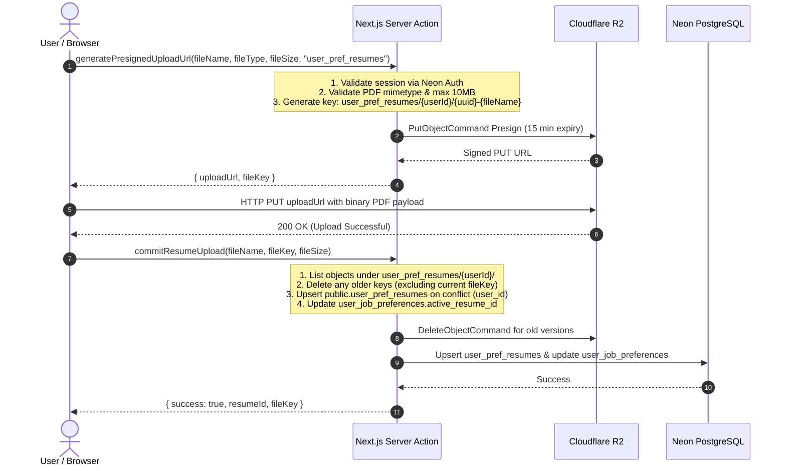
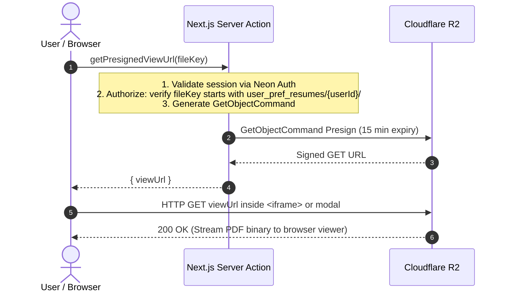
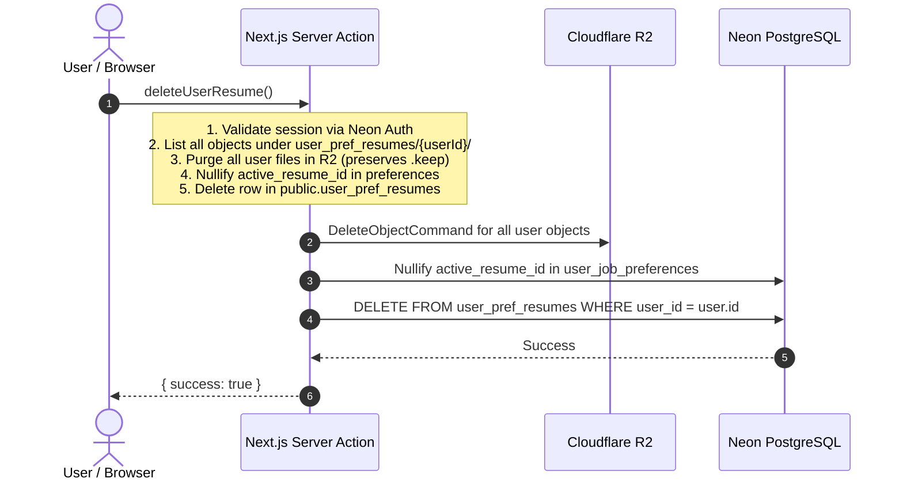

# User Resume Storage & Cloudflare R2 Lifecycle Architecture

This document specifies the end-to-end architecture, lifecycle operations, database models, and object storage conventions for user-uploaded resume PDFs within the Strawberry Jobs application.

---

## 1. System Overview & Core Principles

The user resume management system powers the candidate job profiling workflow (`/job-hunt/manage`). Candidates upload their primary resume PDF to hydrate preference profiles, preview documents, and inform tailoring pipelines.

```
                      +---------------------------------------+
                      |             Client Browser            |
                      |   (React, Zustand, Native Fetch)      |
                      +-------------------+-------------------+
                                          |
                     1. Request Presigned | 3. Direct Binary
                        Upload / View URL |    Transfer (PUT/GET)
                                          v
      +-----------------------------------+-----------------------------------+
      |                                                                       |
      v                                                                       v
+-------------------------------+                           +-----------------------------------+
|     Next.js Backend (Vercel)  |                           |       Cloudflare R2 Storage       |
|          Control Plane        |                           |            Data Plane             |
+---------------+---------------+                           +-----------------+-----------------+
| * Neon Auth Session Check     |                                             |
| * S3 Presigner (@aws-sdk)     |                                             |
| * Drizzle ORM DB Operations   |                                             |
+---------------+---------------+                                             |
                |                                                             |
                v                                                             |
+-------------------------------+                                             |
|    Neon PostgreSQL Database   |                                             |
| * public.user_pref_resumes    |<--------------------------------------------+
| * public.user_job_preferences |        (Referenced by file_key metadata)
+-------------------------------+
```

### Architectural Tenets

1. **Zero Application Server Bandwidth (Data Plane vs. Control Plane Separation)**:
   * Next.js server actions act strictly as the **Control Plane** (validating auth, minting signed URLs, writing metadata).
   * File bytes **never** stream through the Next.js server. The client browser uploads and downloads directly to/from Cloudflare R2 using cryptographic time-limited **Presigned URLs**.
2. **Strict Single Resume Invariant**:
   * A user account can have **at most one active resume PDF** stored in Cloudflare R2 and recorded in the database.
   * Uploading a new resume atomically prunes any pre-existing files for that user in Cloudflare R2.
3. **Directory Immutability & Persistence**:
   * Cloudflare R2 prunes empty prefixes automatically. To guarantee the `user_pref_resumes/` folder structure always persists, a zero-byte sentinel object (`user_pref_resumes/.keep`) is permanently maintained.
4. **Domain Isolation**:
   * User profiling resumes live in `public.user_pref_resumes` and connect exclusively to `public.user_job_preferences.active_resume_id`.
   * They are completely isolated from applicant tracking (`public.applications`) and AI job matching models (`public.resumes` / `matching.results`).

---

## 2. Cloudflare R2 Storage Structure

### 2.1 Bucket Specification

* **Bucket Name**: `joberry-assets` (configured via `R2_BUCKET_NAME`)
* **API Compatibility**: S3 API (AWS SDK v3 `@aws-sdk/client-s3`)
* **Endpoint Pattern**: `https://<R2_ACCOUNT_ID>.<R2_JURISDICTION>.r2.cloudflarestorage.com`

### 2.2 Hierarchy & Object Key Schema

All user profiling resumes reside under the `user_pref_resumes/` top-level prefix:

```
joberry-assets/
└── user_pref_resumes/
    ├── .keep                                                    <-- Sentinel marker (0 bytes)
    └── {userId}/                                               <-- Neon Auth user UUID
        └── {randomUUID}-{sanitized_filename}.pdf               <-- Candidate Resume File
```

#### Key Components:
* **Root Prefix**: Always `user_pref_resumes/`.
* **User Isolation Partition**: `{userId}/` enforces tenant isolation. Operations for a user only inspect or mutate objects under their specific user ID prefix.
* **Collision-Proof File ID**: `{randomUUID}-{sanitized_filename}.pdf` prevents browser cache collisions and timestamp overlaps while preserving human-readable file identification.
* **Sentinel Marker (`.keep`)**: Ensures that even when every user deletes their resumes, the `user_pref_resumes/` directory is never pruned by R2's virtual prefix pruning engine.

### 2.3 Cloudflare R2 Bucket CORS Policy

To allow browsers to upload directly via HTTP `PUT` and preview via `GET`, the bucket enforces the following CORS configuration:

```json
[
  {
    "AllowedOrigins": ["http://localhost:3000", "https://*.joberry.com"],
    "AllowedMethods": ["GET", "PUT", "HEAD"],
    "AllowedHeaders": ["*"],
    "ExposeHeaders": ["ETag"],
    "MaxAgeSeconds": 3600
  }
]
```

---

## 3. Database Schema & Relations

### 3.1 `public.user_pref_resumes`

This dedicated table stores the metadata and lifecycle state of the user's active profiling resume.

```sql
CREATE TABLE public.user_pref_resumes (
    id UUID PRIMARY KEY DEFAULT gen_random_uuid(),
    user_id TEXT NOT NULL,
    title TEXT NOT NULL,
    file_name TEXT,
    file_key TEXT,
    file_size INTEGER,
    file_url TEXT,
    is_primary BOOLEAN NOT NULL DEFAULT true,
    content TEXT,
    parsed_data JSONB DEFAULT '{}'::jsonb,
    created_at TIMESTAMPTZ NOT NULL DEFAULT now(),
    updated_at TIMESTAMPTZ NOT NULL DEFAULT now(),
    CONSTRAINT idx_user_pref_resumes_user_id_unique UNIQUE (user_id)
);
```

#### Field Explanations:
* `id`: Unique database identifier for the resume record.
* `user_id`: Neon Auth user identifier (foreign reference to `neon_auth.users.id`). Enforces `UNIQUE(user_id)` so no user can have multiple profiling resume rows.
* `title`: User-facing label (defaults to the original uploaded file name).
* `file_name`: Original name of the uploaded PDF file (e.g. `Jane_Doe_Resume_2026.pdf`).
* `file_key`: The exact Cloudflare R2 object key (e.g. `user_pref_resumes/1f7f56d4.../cb8ef576...-Jane_Doe_Resume_2026.pdf`).
* `file_size`: Integer byte count of the file.
* `file_url`: Mirrors `file_key` for backward compatibility with downstream serializers.
* `is_primary`: Set to `true` for preference profiling resumes.
* `content`: Plain text extracted from the PDF (populated when resume parsing triggers).
* `parsed_data`: Structured JSON containing skills, education, and experience entities.

### 3.2 Relation to `public.user_job_preferences`

The preferences record links to the active resume record via a nullable Foreign Key:

```sql
ALTER TABLE public.user_job_preferences
ADD COLUMN active_resume_id UUID REFERENCES public.user_pref_resumes(id) ON DELETE SET NULL;

CREATE INDEX idx_user_job_preferences_active_resume_id 
ON public.user_job_preferences (active_resume_id);
```

When a user deletes their profiling resume, `ON DELETE SET NULL` ensures the preferences row remains intact while decoupling the deleted file.

---

## 4. End-to-End CRUD Operations

### 4.1 Create / Upload Flow



#### Step-by-Step Implementation:
1. **Client Pre-check**: Browser validates file extension (`.pdf`), MIME type (`application/pdf`), and maximum file size (10 MB).
2. **Control Plane Presigning**:
   * Function: `generatePresignedUploadUrl` in `app/actions/storage.ts`.
   * Input: `{ fileName, fileType, fileSize, prefix: "user_pref_resumes" }`.
   * Generates a signed AWS S3 `PutObjectCommand` valid for 900 seconds (15 minutes).
3. **Direct Data Plane PUT**:
   * Client issues `fetch(uploadUrl, { method: "PUT", body: file, headers: { "Content-Type": "application/pdf" } })`.
   * Data routes directly between user ISP and Cloudflare edge; Next.js server consumes zero I/O bandwidth.
4. **Metadata Commit & Auto-Pruning**:
   * Function: `commitResumeUpload` in `app/actions/storage.ts`.
   * Pruning: Queries `ListObjectsV2Command` under prefix `user_pref_resumes/${user.id}/`. Any key differing from the newly uploaded `fileKey` is immediately deleted with `DeleteObjectCommand`.
   * DB Upsert: Inserts or updates `public.user_pref_resumes` using `ON CONFLICT (user_id) DO UPDATE`.
   * Linkage: Sets `active_resume_id` in `public.user_job_preferences`.

---

### 4.2 Read / Preview / Download Flow



#### Step-by-Step Implementation:
1. **Resume Fetching**: On page load, `getUserActiveResume()` retrieves metadata from `public.user_pref_resumes`.
2. **Secured Link Generation**:
   * When user clicks "Preview File", browser calls `getPresignedViewUrl(fileKey)`.
   * Server verifies that `fileKey` begins with `user_pref_resumes/${session.user.id}/` (strictly preventing cross-tenant document viewing).
   * Generates a signed AWS S3 `GetObjectCommand` URL valid for 15 minutes.
3. **Client-side Rendering**:
   * Passed into `PdfPreviewModal.tsx` and embedded via a secure `<iframe src={viewUrl} />` or downloaded via browser blob anchor.

---

### 4.3 Update / Replace Flow

When a user replaces an existing resume with a newer version:

1. The client invokes the standard **Upload Flow** with the new file.
2. The file is uploaded to a brand-new unique object key (`{newUuid}-{fileName}.pdf`).
3. Upon calling `commitResumeUpload`:
   * The server scans `user_pref_resumes/${user.id}/`.
   * The previous file (e.g. `{oldUuid}-{oldFileName}.pdf`) is purged from R2.
   * The single record in `public.user_pref_resumes` is updated in place.
   * `public.user_job_preferences.active_resume_id` is updated with the latest ID.
4. Result: Zero leftover storage overhead in R2; exactly one active PDF exists.

---

### 4.4 Delete / Purge Flow



#### Step-by-Step Implementation:
1. **Trigger**: User clicks "Remove" button in `app/(main)/job-hunt/manage/page.tsx`.
2. **Server Action**: Invokes `deleteUserResume()` in `app/actions/storage.ts`.
3. **R2 Cleanup**:
   * Calls `ListObjectsV2Command` for `user_pref_resumes/${user.id}/`.
   * Deletes all matching objects.
   * Root marker `user_pref_resumes/.keep` is left unaffected.
4. **Database Cleanup**:
   * Updates `public.user_job_preferences` setting `active_resume_id = NULL`.
   * Clears legacy `preferences.resumeFileKey` JSONB reference.
   * Deletes the row from `public.user_pref_resumes WHERE user_id = user.id`.
5. **UI Update**: Client clears local form state and updates reactive UI buttons to "Upload Resume".

---

## 5. Security & Access Control

1. **Private Bucket Policy**:
   * Cloudflare R2 bucket `joberry-assets` does **not** have public read access enabled.
   * Files can only be accessed through time-limited presigned URLs minted with the account's secret access key.
2. **Strict Ownership Validation**:
   * Control plane operations verify that the authenticated `user.id` matches the path prefix `user_pref_resumes/${user.id}/` before issuing any presigned GET or executing any R2 deletion.
3. **URL Expiration**:
   * All presigned upload and view URLs expire after **900 seconds (15 minutes)**.
4. **Sanitized File Names**:
   * Non-alphanumeric characters in file names are stripped or normalized to prevent path traversal or header injection during presigning.

---

## 6. Codebase File Map & Responsibilities

| File Path | Role | Key Functions / Responsibilities |
| :--- | :--- | :--- |
| `lib/storage/r2-client.ts` | **Infrastructure** | Singleton AWS S3 client configured with R2 endpoint, account ID, and credentials. |
| `app/actions/storage.ts` | **Control Plane** | `generatePresignedUploadUrl`, `commitResumeUpload`, `getPresignedViewUrl`, `deleteUserResume`, `getUserActiveResume`. |
| `lib/db/schema/applications.ts` | **Database Schema** | Defines `userPrefResumes` table schema and original `resumes` table schema. |
| `lib/db/schema/preferences.ts` | **Database Schema** | Defines `userJobPreferences` table with foreign key `activeResumeId`. |
| `app/actions/preferences.ts` | **Controller** | `getJobPreferences`, `saveJobPreferences` (hydrates and syncs preferences with `userPrefResumes`). |
| `app/(main)/job-hunt/manage/page.tsx`| **UI View / Form** | Candidate profile view with Upload, Preview, and Remove controls. |
| `components/PdfPreviewModal.tsx` | **UI Component** | Modal dialog rendering the presigned PDF view in an `<iframe>`. |
| `scripts/setup-r2-cors.ts` | **DevOps / Script** | CLI script that applies the CORS policy to the `joberry-assets` R2 bucket. |
