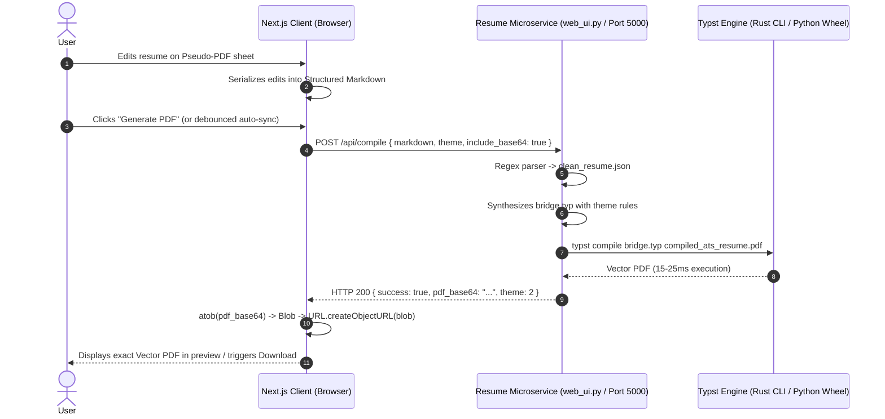

# Next.js ⇄ Typst PDF Engine Integration Guide

This document defines the architecture, data contract, styling metrics, and asynchronous synchronization pipeline connecting a **Next.js frontend application** to this **Python/Rust Typst Resume Compiler** microservice.

---

## 1. System Architecture & Flow



---

## 2. The Visual Parity Problem & Solution

### The Problem: Font & Line-Break Drift
If a browser renders text in arbitrary screen pixels (`px` or `rem`) and flexible widths, a bullet point might wrap onto a second line at word 15, whereas Typst (which operates on physical typography points `pt` and millimetric page margins) might wrap it at word 16. A single stray line wrap pushes subsequent sections downward and spills a 1-page resume onto an unwanted 2nd page.

### The Solution: CSS Physical Unit Locking
To guarantee that what the user sees on the screen matches the Typst PDF with 100% fidelity:

1. **Lock Paper Dimensions to Physical US Letter**:
   ```css
   .pseudo-pdf-sheet {
     width: 8.5in;
     min-height: 11in;
     max-height: 11in; /* Hard boundary for 1-page resumes */
     box-sizing: border-box;
     background: #ffffff;
     color: #000000;
     overflow: hidden;
   }
   ```
2. **Lock Margins to `bridge.typ` Specifications**:
   - **Themes 2, 3, 5**: `padding: 0.8cm 1.0cm;`
   - **Theme 6**: `padding: 0.8cm 1.1cm;`
3. **Lock Typography & Leading**:
   - **Themes 2, 3**: `font-family: Arial, sans-serif; font-size: 8.5pt; line-height: calc(8.5pt + 0.48em);`
   - **Theme 5**: `font-family: "Times New Roman", serif; font-size: 8.6pt; line-height: calc(8.6pt + 0.46em);`
   - **Theme 6**: `font-family: Arial, sans-serif; font-size: 8.8pt; line-height: calc(8.8pt + 0.48em);`
4. **Responsive Zoom via CSS Transform**:
   Keep the paper fixed at `8.5in` and scale the parent wrapper using `transform: scale(zoomLevel)` so text wrapping never alters when resizing browser windows.

---

## 3. The API Contract

### Request: `POST /api/compile`
- **URL**: `http://<server-ip>:5000/api/compile`
- **Headers**: `Content-Type: application/json`
- **Payload Schema**:
  ```typescript
  interface CompilePayload {
    markdown: string;              // Full Markdown text of the resume
    theme?: 2 | 3 | 5 | 6;         // 2: Jake's, 3: Modern, 5: Executive, 6: Minimal Tech
    include_base64?: boolean;      // Set true to receive the PDF string in response
    destination_endpoint?: string; // Optional: Webhook URL to dispatch PDF + MD
  }
  ```

### Response Schema:
```json
{
  "success": true,
  "theme": 2,
  "pdf_url": "/compiled_ats_resume.pdf",
  "pdf_base64": "JVBERi0xLjcgCjEgMCBvYmoK...",
  "json_data": {
    "personal_information": { "name": "...", "email": "..." },
    "professional_summary": ["..."],
    "technical_skills": { "...": "..." },
    "professional_experience": [...],
    "education": [...],
    "projects": [...],
    "section_order": ["summary", "skills", "experience", "projects", "education"]
  },
  "typst_code": "#set page(...)...",
  "stdout": "Successfully generated compiled_ats_resume.pdf using 'Jake's Resume'",
  "stderr": ""
}
```

---

## 4. Markdown Generation Contract

The backend regex parser (`py_compiler.py` / `src/main.rs`) requires specific syntax cues to populate `clean_resume.json`:

```markdown
# Alexander Hamilton
**Principal Cloud Architect**

+1 415-555-0199 | alex@example.com | linkedin.com/in/alexhamilton | github.com/alexhamilton | New York, NY

## Professional Summary
- Architected enterprise multi-cloud data infrastructure across AWS and GCP, processing 10B+ events daily.
- Led cross-functional engineering teams of 14 senior engineers across distributed systems and ML deployments.

## Technical Skills
- **Cloud & Platforms:** AWS, GCP, Azure, Kubernetes, Docker, Terraform
- **Languages & Frameworks:** Python, TypeScript, Rust, Go, Next.js, React, Node.js
- **Data & Storage:** PostgreSQL, Redis, Snowflake, BigQuery, Apache Kafka, Spark

## Professional Experience

### Senior Staff Software Engineer | Stripe | San Francisco, CA | Jan 2024 - Present
- Spearheaded redesign of core ledger database, improving transaction write throughput by 45%.
- Implemented real-time anomaly detection pipelines processing over $2B in monthly settlements.

### Lead Infrastructure Engineer | Coinbase | Remote | Mar 2021 - Dec 2023
- Orchestrated migration of 120+ microservices to Kubernetes, reducing compute infrastructure spend by 30%.
- Established automated blue/green deployment pipelines with zero customer-facing downtime.

## Technical Projects

### Distributed Consensus Engine | Rust, Raft, Tokio | 2024
- Implemented Raft distributed consensus protocol from scratch in Rust, achieving 15k ops/sec.
- Designed automated partition recovery with automated snapshotting and disk persistence.

## Education

**University of California, Berkeley** — Berkeley, CA
*Master of Science in Computer Science* | 2022 - 2024
**Relevant Coursework:** Distributed Systems, Advanced Database Design, Deep Learning
```

### Parsing Rules Summary

| Field | Markdown Syntax Required by Backend Parser |
| :--- | :--- |
| **Candidate Name** | Top line `# Name` or prominent `**Name**` |
| **Title / Role** | Second line `**Title**` (without `@` or links) |
| **Contacts** | Line containing email (`@`), phone, linkedin/github links, separated by `\|` |
| **Section Titles** | `## Professional Summary`, `## Technical Skills`, `## Professional Experience`, `## Technical Projects`, `## Education` |
| **Job Entries** | `### Role \| Company \| Location \| Duration` followed by `- ` bullets |
| **Project Entries** | `### Project Name \| Technologies \| Duration` followed by `- ` bullets |
| **Skill Entries** | `- **Category:** Item1, Item2, Item3` |
| **Education** | `**Institution** — Location` followed by `*Degree* \| Duration` |

---

## 5. Theme Directory & Selection

| ID | Name | Font Family | Header Style | Section Accents |
| :---: | :--- | :--- | :--- | :--- |
| **`2`** | **Jake's Resume** *(Default)* | Arial (8.5pt) | Centered | Bold title with `0.6pt` solid horizontal rule |
| **`3`** | **Modern Clean** | Arial (8.5pt) | Centered, Gray subtitle | Uppercase gray title with `0.5pt` thin divider |
| **`5`** | **Classic Executive** | Times New Roman (8.6pt) | 2-column split (Name left, Contact right) | Serif uppercase with solid line divider |
| **`6`** | **Minimal Tech** | Arial (8.8pt) | Left-aligned | `3.5pt` solid black vertical accent bar on left |

---

## 6. Real-Time Single-Page Overflow Detection

To prevent the user from being surprised when Typst outputs a 2-page document, install an overflow detector on the paper DOM element:

```typescript
const checkOverflow = () => {
  const el = sheetRef.current;
  if (!el) return;
  // 11 inches is 1056px at 96 DPI
  const isOverflow = el.scrollHeight > el.clientHeight + 2;
  setHasOverflow(isOverflow);
};
```

When `hasOverflow` is true, render a warning banner in Next.js:
> ⚠️ **Page Budget Exceeded**: Content extends beyond the 1-page boundary. Typst will generate a 2-page document. Shorten bullet points to maintain a single-page ATS resume.

---

## 7. How an AI Agent Should Build the Next.js UI

When assigning an AI coding agent to implement or modify the Next.js frontend:

1. **Activate the Skill**: Ensure the agent loads [`.agents/skills/nextjs-resume-wysiwyg/SKILL.md`](file:///c:/Users/geeth/joberryresumebuilderrust/resume-builder-agent/.agents/skills/nextjs-resume-wysiwyg/SKILL.md).
2. **Enforce Metric Locking**: Inspect the CSS to ensure `width: 8.5in`, `min-height: 11in`, and physical `pt` font sizing are used inside the paper container.
3. **Verify Serialization**: Ensure the serialization function outputs strict Markdown matching the table in Section 4.
4. **Implement Debounced Background Sync**: Allow editing without UI freeze by compiling in the background (600ms debounce) and decoding the `pdf_base64` response directly into an object URL.
